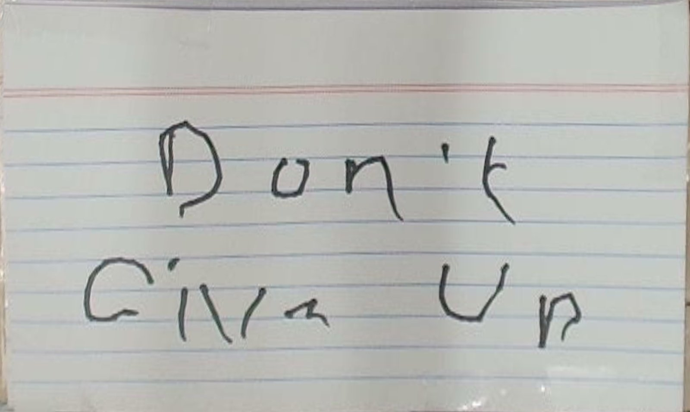
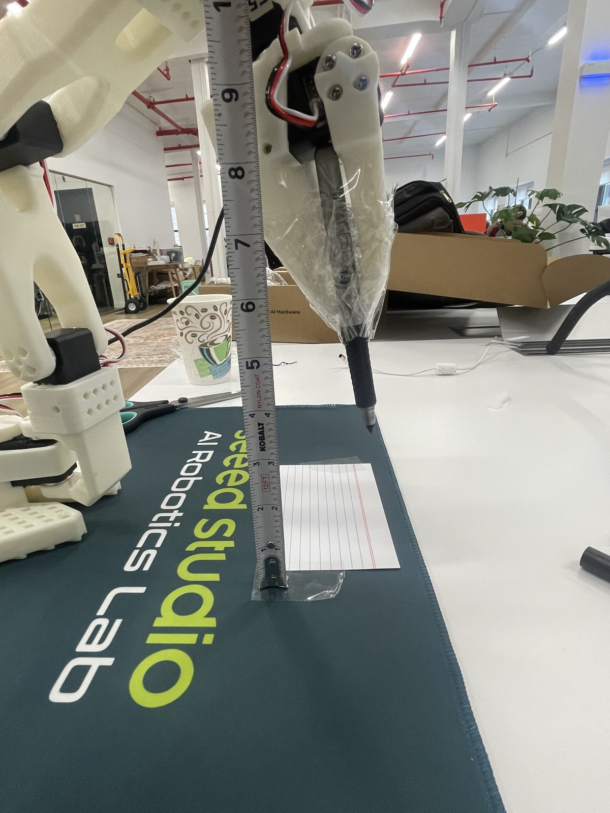
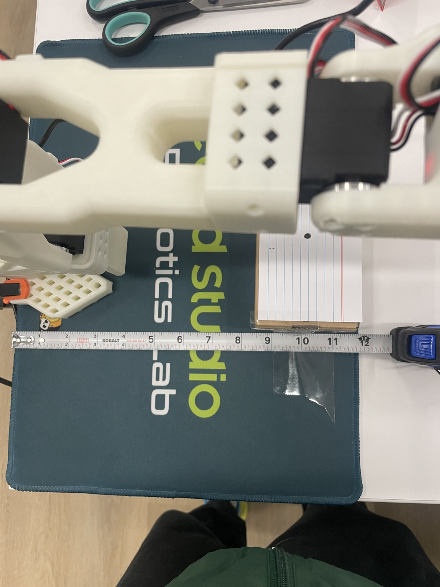
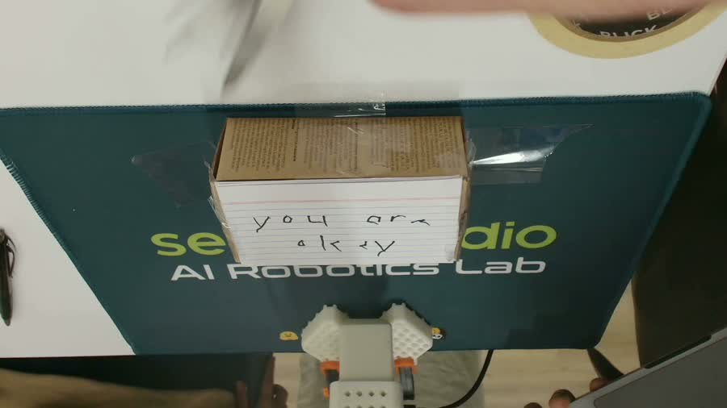
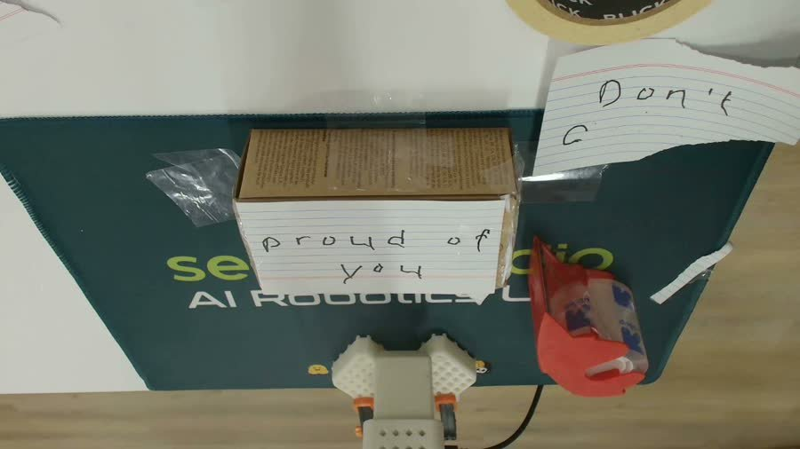
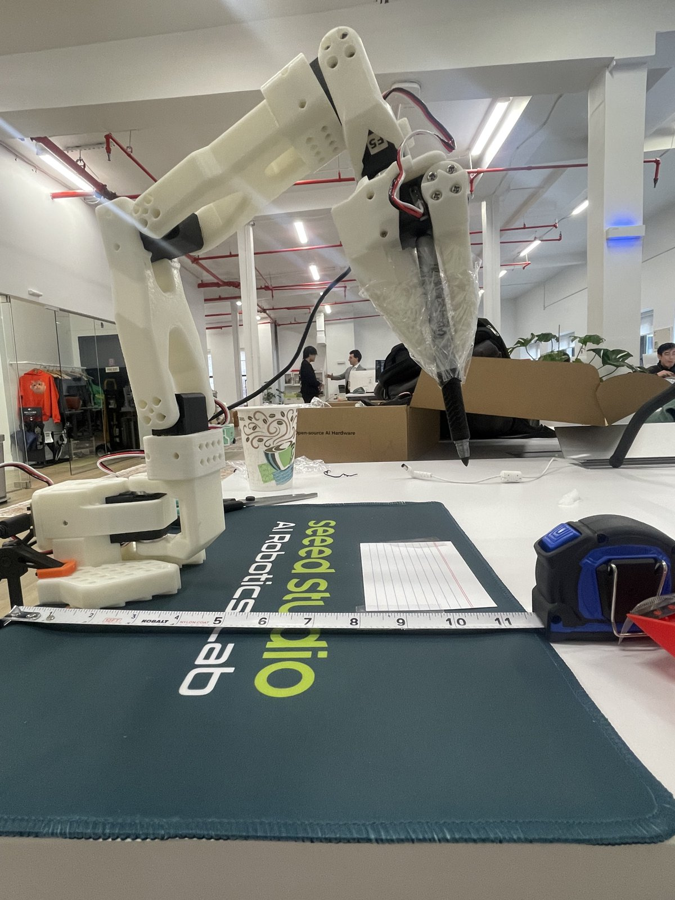

# Hand-Me-Down

A visitor handwrites an index card. A robot hands back a few words that another person wrote. The AI writes none of them.

Built in one day at the NYC Non-Slop Hackathon, 22 Nov 2026, by Alex Wu and Carson Weeks, on an SO-101 arm with a ballpoint pen taped into its gripper.

## Why

The hackathon asked what matters when anything can be generated. Our answer was a place where every word still comes from a person. The model is allowed to read, screen and choose. It is not allowed to write.

## What happens

1. You write what you are carrying on a 3x5 card and put it on the box under the camera.
2. The overhead camera takes a frame and Reducto reads your handwriting. The text goes on the screen.
3. A Hermes agent with no tools labels the card: ok, self_harm, threat, hate, sexual or private_info. Anything but ok holds the card for a person. Phone numbers, emails, links and handles are held by rule and never reach a model.
4. A second Hermes agent reads your card and the reply cards people left before you. It has exactly one tool, `give`, and may only hand over a phrase that already exists on one of those cards, two or three consecutive words, at most 40 characters. A hook checks the phrase against the card text and rejects anything changed or invented.
5. The SO-101 writes that phrase in ink on the blank card under yours. It starts only after your card has left the box and the blank card is still.
6. You take the card. Someone wrote those words by hand earlier; the arm just passed them on.

## Pictures

| | |
|---|---|
|  |  |
| The arm and its pen | The rig from above: arm, riser box, card under the camera |
|  |  |
| The seed reply card, written by hand | A vent card, the kind a visitor writes |
|  |  |
| 16:42, "you are okay", 50 s | 18:13, "proud of you", 49 s |

Visitors' cards are not in this repo. Everything shown was written by the team or by the arm. More test writes, with measurements, are in [docs/evidence](docs/evidence/README.md).

## What ran on stage

Six ink runs were delivered on 22 Nov:

| Time | Inked | Writing time |
|---|---|---|
| 15:46 | Don't Give Up | 51 s |
| 16:12 | Keep pushing You'll | 64 s |
| ~16:15 | I hope you | about 41 s |
| 16:42 | you are okay | 50 s |
| 18:13 | proud of you | 49 s |
| 18:15 | don't worry | 48 s |

The first two live runs were fragments. A phrase rule fixed at 16:23 stopped that (no phrase may end on a weak word or begin right after a negation, so "don't give up" cannot become "give up"), and the three runs after it were complete replies. The live rail had 5 reply cards and 8 phrases: one handwritten, four typed human lines from the GoEmotions archive shown with an ARCHIVE stamp.

A reply took roughly 15 to 18 s to reach the screen and about 50 s to write. That was too slow for what we wanted, which was an immediate answer.

## The sponsors' parts, honestly

- **Hermes Agent** (v0.23.3, in Docker): two profiles. The gate has no tools, no skills, memory off, one turn. The chooser has one tool, `give`, and a hook on `pre_tool_call` that fails closed. The container sees only `card/` and `cache/turn/`, read-only. `python -m card hermes check` prints every one of those checks.
- **Reducto** reads the handwriting. On five ballpoint test cards it read 27 of 28 words.
- **Pangram** audited the message bank offline: 51 lines, 17 human (GoEmotions), 17 model-written and labeled, 17 model rewrites of the human lines. It flagged 0 of 17 human lines as AI and caught 13 of 17 AI lines. That is under the 0.8 bar we set, so Pangram stayed out of the live gate. Scores are in `docs/results/pangram-bank-2026-11-22.json`.
- The model behind both Hermes profiles was `deepseek/deepseek-v4.1-flash` through OpenRouter.

## Known limits

- The arm writes in a pen font. Trace mode, which would copy the original writer's strokes, is not implemented.
- Some strokes are faint or uneven, and the on-screen reveal cut off a trailing "!!".
- Pen height is one value for the whole card (first ink at 49 mm, writing at 46 mm). Move the box or the pen and you measure it again.
- On stage the worker drove the arm directly for speed. The bounded Hermes arm role in `sim/arm_mcp.py` ran one supervised write, which narrowly missed its ink check; see `docs/evidence`.
- `arm relax` frees only the shoulder lift and elbow. To make the whole arm limp, disable torque on every motor and read `Torque_Enable` back.

## Repo map

- `card/`: card server, camera capture, Reducto read, the two Hermes profiles, the quote rules and hook, the message bank, the operator and visitor pages.
- `sim/`: `armd.py` holds the arm at 50 Hz, `arm_worker.py` plans the pen path and writes `done/NNN.json`, `camd.py` serves the cameras, plus the twin and calibration tools.
- `screen/`: the visitor screen.
- `docs/evidence/`: real-arm test writes with measurements and the Hermes-driven run. `docs/results/`: Hermes gate and chooser runs, Pangram scores.
- `ARM_STATUS.md`: how to run the stage stack, the job and pose interfaces, and the full list of limits.

## Run it

Only start the worker with someone at the arm. It moves the pen as soon as a job arrives and the card is clear. The commands, the two Hermes profiles and the environment variables are in [ARM_STATUS.md](ARM_STATUS.md#run-it).

Tests: `python -m pytest card/tests` (131 passed, 2 skipped at the final commit).

## Team

Alex Wu (arm, pen path, cameras, calibration) and Carson Weeks (card side, Hermes profiles, Reducto, screen, Pangram eval).
