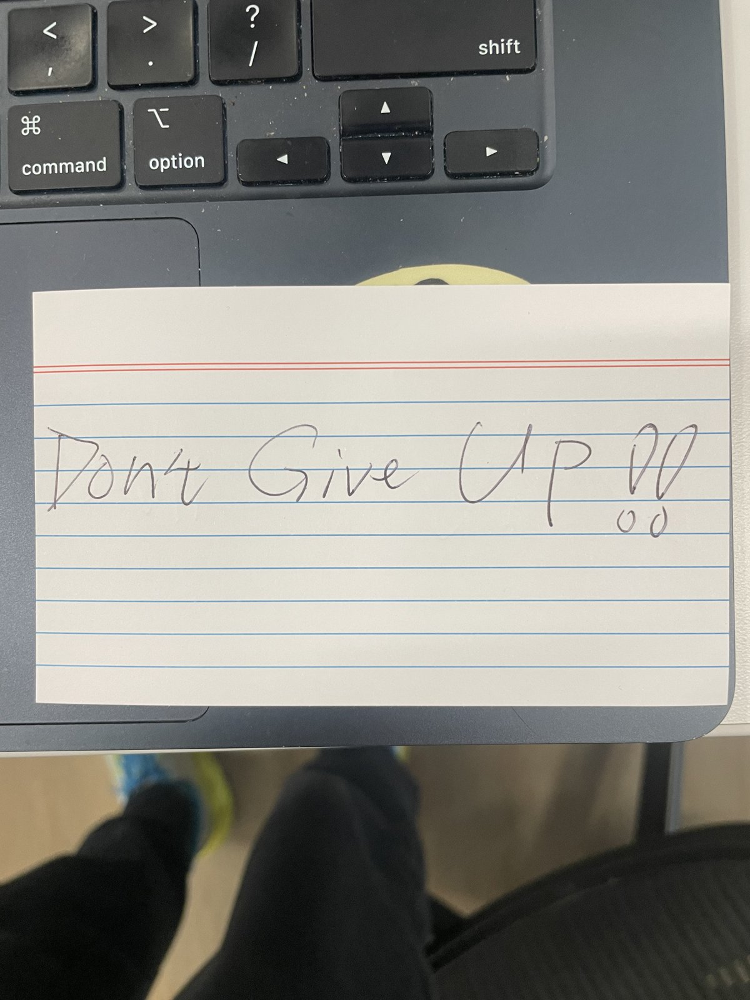
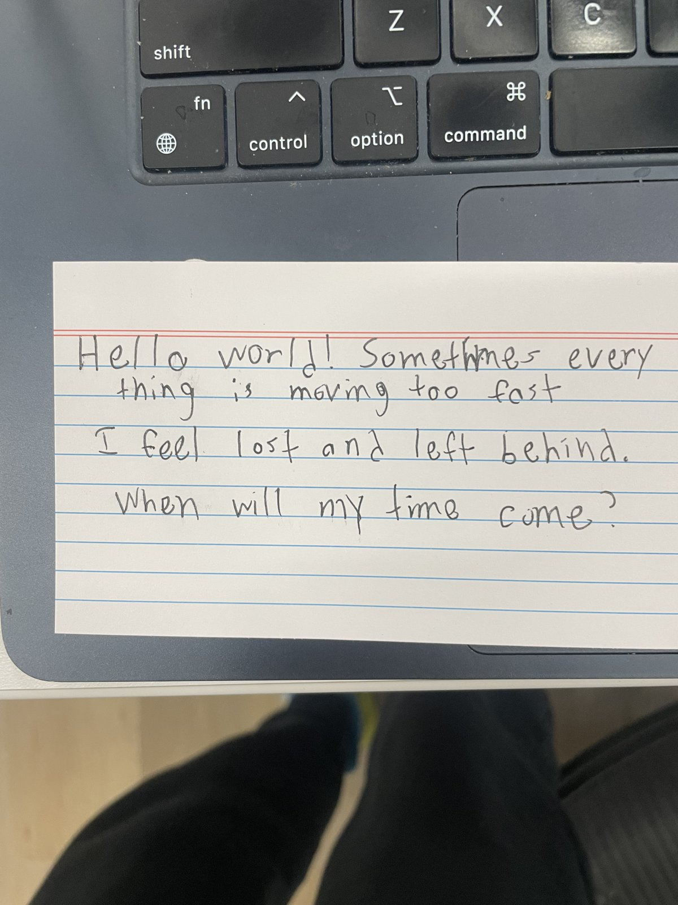

# Hand-Me-Down

You handwrite a card. A robot hands you back a few words that another person wrote. The AI writes none of them.

NYC Non-Slop Hackathon, 22 Nov 2026. Alex Wu and Carson Weeks. One SO-101 arm, one ballpoint pen, a box of index cards.

## How it works

Card goes on the box → camera and Reducto read it → a Hermes gate screens it → a second Hermes picks a real phrase from the cards people left (one tool, exact words only, a hook rejects anything changed) → the arm writes it in ink → you keep the card.

## Pictures

| | |
|---|---|
|  |  |
|  |  |
|  |  |

Six cards were written on stage: Don't Give Up · Keep pushing · I hope you · you are okay · proud of you · don't worry. About 50 seconds of ink each. More test writes in [docs/evidence](docs/evidence/README.md).

## Built with

Hermes Agent (gate + chooser profiles) · Reducto (handwriting) · Pangram (bank audit) · OpenRouter · SO-101 + LeRobot

## Repo

`card/` card server, Hermes profiles, quote rules · `sim/` arm server, pen path, cameras · `screen/` visitor screen · `docs/` evidence and results · [ARM_STATUS.md](ARM_STATUS.md) to run it

Tests: `python -m pytest card/tests`
